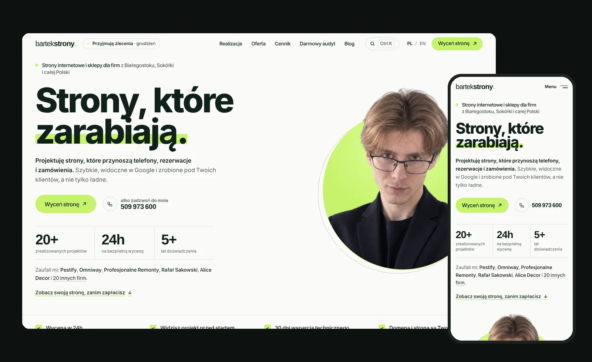

# bartekstrony.pl

Moja strona-portfolio. Pokazuje realizacje, przyjmuje zapytania od klientów i ma kilka narzędzi, które pomagają firmom podjąć decyzję: darmowy audyt strony, konfigurator wyceny i podgląd „jak mogłaby wyglądać Twoja strona”.

**Na żywo: [bartekstrony.pl](https://bartekstrony.pl)**



## Co jest w środku

- **Realizacje**: ponad 20 projektów ze zrzutami, opisami i linkami do działających stron
- **Darmowy audyt**: wpisujesz adres, a strona sprawdza wydajność przez PageSpeed Insights API i pokazuje, co poprawić
- **Wycena**: konfigurator z cenami „od” i dodatkami, wynik trafia prosto do formularza kontaktowego
- **„Zobacz swoją stronę”**: generator podglądu strony dla wybranej branży, zanim klient cokolwiek zapłaci
- **Podstrony SEO**: osobne strony dla branż i miast, blog w MDX, mapa strony, dane strukturalne (schema.org), `llms.txt`
- **Panel `/control`**: zapytania z formularzy (Vercel Blob) i statystyki z Google Analytics w jednym miejscu
- **Wersja PL i EN**, wyszukiwarka pod `Ctrl K` i obrazki OG generowane dla każdej podstrony

Prawie wszystko jest generowane statycznie (ok. 200 stron), więc strona szybko się ładuje także na telefonie.

## Stack

Next.js 16 (App Router) · React 19 · TypeScript · Tailwind CSS v4 · GSAP + Lenis · MDX · Zod · Vercel (hosting, Blob)

## Uruchomienie

```bash
npm install
npm run dev     # http://localhost:3000
npm run build   # build produkcyjny
npm start       # podgląd buildu
```

Zmienne środowiskowe są opisane w [`.env.example`](.env.example). Bez nich strona też działa, tylko audyt, panel i statystyki są wyłączone.

| Zmienna | Do czego |
|---|---|
| `CONTROL_PASSWORD`, `CONTROL_SECRET` | logowanie do panelu `/control` |
| `BLOB_READ_WRITE_TOKEN` | zapis zapytań z formularzy (prywatny Vercel Blob) |
| `NEXT_PUBLIC_PSI_API_KEY` | klucz PageSpeed Insights API dla `/audyt` |
| `NEXT_PUBLIC_GA_ID` | Google Analytics (ładuje się dopiero po zgodzie na cookies) |
| `GA_PROPERTY_ID`, `GA_CLIENT_EMAIL`, `GA_PRIVATE_KEY` | statystyki GA w panelu |

## Gdzie co edytować

Treści są oddzielone od komponentów i siedzą w `src/content/`:

| Co | Plik |
|---|---|
| Dane kontaktowe, menu, liczby w hero | `site.ts` |
| Realizacje (zrzuty w `public/work/`) | `projects.ts` |
| Opinie klientów | `testimonials.ts` |
| Usługi, cennik, konfigurator wyceny | `services.ts`, `pricing.ts` |
| FAQ | `faq.ts` |
| Branże i miasta | `industries.ts`, `cities.ts` |
| Blog | `blog/*.mdx` + `blog/posts.ts` |
| Generator podglądu stron | `preview-kits.ts` |

## Kontrola jakości

W `scripts/` są skrypty, które odpalam na buildzie produkcyjnym (`npx next start -p 3100`) przed większym wdrożeniem:

- `crawl.mjs`: przechodzi po wszystkich podstronach i sprawdza statusy, H1, tytuły, opisy, canonical, alty i martwe linki
- `e2e-smoke.mjs`: test całego lejka, od generatora przez formularz po API
- `screenshot.mjs` + `tile.cjs`: zrzuty desktop i mobile do porównania
- `lh-report.cjs`, `bundle-report.cjs`: czytelny raport z Lighthouse i z wagi JS
- `og-static.mjs`, `og-portrait.mjs`, `cutout-portrait.mjs`, `favicon-ico.mjs`: generowanie obrazków OG i favicony

---

Projekt i realizacja: **Bartłomiej Kulesz** · [bartekstrony.pl](https://bartekstrony.pl)
